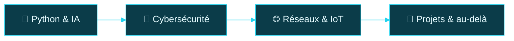

<!-- En-tête animé : dégradé bleu foncé → turquoise → cyan -->

<!-- Citations qui s'écrivent -->

 

---

## 👋 À propos de moi 

Étudiant en **DUT Télécommunications & Réseaux** à l'**École Supérieure Polytechnique (ESP/UCAD)** de Dakar, je me forme aux réseaux, à l'IoT, à la cybersécurité et à l'intelligence artificielle. J'aime construire des choses concrètes et apprendre en pratiquant.

- 🔭 **En ce moment** : Build my Saas😶‍🌫️🥸🥸
- 🌱 **J'apprends** : Python, JavaScript, Java, C, Cisco
- 🧭 **Feuille de route** : `Python / IA` → `Cybersécurité` → `Réseaux / IoT`
- 🤝 **Engagements** : ISOC Club · RoboTech Club · Comité d'organisation de l'ESP
- 🥋 **Sports** : Basketball · Judo
- 🗣️ **Langues** : Français (principal) · Anglais

---

## 🛠️ Stack & outils

 

---

## 🗺️ Feuille de route

---

## 🎮 Projets & expérimentations

| Projet | Description | Technologies |
| :-- | :-- | :-- |
| 🔑 **Connexion Page** | Page de connexion en cours de développement | HTML · CSS · JavaScript |
| 🧱 **Jeux Roblox** | Création de jeux et d'outils avec Roblox Studio | Luau · Roblox Studio |
| 🤖 **Écosystème Google AI** | Petites applications avec Google AI Studio et Opal | IA générative |
| 🌐 **Labs réseaux** | Simulations et configurations Cisco & Huawei | Cisco · Huawei |

---

## 📊 Statistiques GitHub & Performance

<!-- Carte de synthèse complète (générée par GitHub Actions : voir .github/workflows/metrics.yml) -->

 

 

### 🐍 Activité de contributions

<!-- Serpent animé qui mange les contributions (généré par .github/workflows/snake.yml) -->

 

---

## 🏀 En dehors du code

Basketball et judo, curiosité pour tout ce qui touche à la tech, et envie de créer de petits outils avec les IA de Google. Le sport m'apprend la discipline, le respect et la persévérance : tomber sept fois, se relever huit.

<!-- Mini animation : tir, panier, rebond (fichier assets/basketball.svg) -->

  

<!-- Mini animation : prise, projection, ippon (fichier assets/judo.svg) -->

---

## 📫 Me contacter

  

